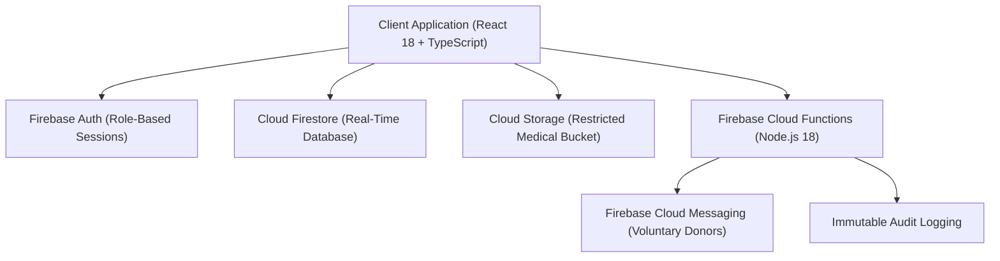

# LifeBridge India — Transparent Medical Support & Rare Disease Care Platform

[](https://www.typescriptlang.org/)
[](https://react.dev/)
[](https://vitejs.dev/)
[](https://firebase.google.com/)
[](LICENSE)
[](#verification)

LifeBridge India is a production-grade, zero-commission medical support and rare disease care platform designed for high-impact pediatric treatment coordination (including Spinal Muscular Atrophy, Duchenne Muscular Dystrophy, and Thalassemia Major).

The platform addresses critical gaps in medical crowdfunding through a **5-stage human verification model**, **0% platform commission accounting**, **real-time public ledger transparency**, and a **voluntary blood donor coordination network**.

---

## 🏗️ System Architecture



---

## ✨ Key Engineering Features

- **🔒 Real Firebase Source of Truth**: Operating strictly on Cloud Firestore, Firebase Auth, Cloud Storage, and Functions — zero fabricated demo records or local mock fallbacks.
- **🛡️ 5-Stage Hope Verification Standard**: Campaigns require independent verification across 5 checkpoints: Identity Proof, Diagnostic Medical Reports, Attending Doctor Desk, Hospital Billing Desk, and Itemized Treatment Estimates.
- **👥 Role-Based Access Control (RBAC)**: Role-isolated workspaces for `DONOR`, `PATIENT_FAMILY`, `VOLUNTEER`, `DOCTOR`, `HOSPITAL`, `CSR`, and `ADMIN`. Privileged role elevation is blocked client-side and enforced backend-side via Firestore Security Rules.
- **🧾 Open Financial Ledger**: Every confirmed contribution records an immutable transaction entry in the `transparency` collection with a strict 0% platform commission policy.
- **🩸 Voluntary Blood Donor Network**: Voluntary standby donor matching by blood group (A+, B+, O-, etc.) and city without publicly exposing donor phone numbers or private PII.
- **🎨 Production UI & High Contrast**: Built using tokenized CSS styling with explicit button contrast rules (`.btn-primary` blue + white text, `.btn-emergency` red + white text).

---

## 📁 Repository Structure

```
lifebridge-india/
│
├── docs/                             # Engineering & System Documentation
│   ├── architecture.md               # System Topology & Subsystems
│   ├── security.md                   # RBAC Matrix & Security Rules
│   ├── data-model.md                 # Firestore Collection Specifications
│   ├── verification-workflow.md      # 5-Stage Hope Verification Standard
│   ├── deployment.md                 # CI/CD & Firebase Deployment Pipeline
│   └── testing.md                    # Testing Strategy & Verification
│
├── functions/                        # Firebase Cloud Functions (Node.js 18)
├── public/                           # Static Web Assets
│
├── src/                              # React 18 TypeScript Source Code
│   ├── components/                   # UI Components & Dashboard Views
│   │   ├── dashboard/                # Role-Specific Workspaces
│   │   ├── home/                     # Landing Page Sections
│   │   ├── layout/                   # Header, Footer, Banner
│   │   └── modals/                   # Auth, Donation, Emergency, Apply
│   ├── context/                      # AuthContext & State Provider
│   ├── pages/                        # Page Views & Router Components
│   ├── services/                     # Firebase API Services & SDK
│   ├── styles/                       # CSS Tokens & Global Styles
│   └── types/                        # Data Interfaces & Data Models
│
├── firestore.rules                   # Firestore Security Rules
├── storage.rules                     # Cloud Storage Access Rules
├── firestore.indexes.json            # Firestore Compound Query Indexes
├── firebase.json                     # Firebase Project Configuration
├── tsconfig.json                     # TypeScript Strict Config
├── vite.config.ts                    # Vite Bundler Config
├── LICENSE                           # MIT License
└── README.md                         # Main Documentation Manifest
```

---

## 🚀 Quick Start Guide

### Prerequisites
- Node.js v18.0.0 or higher
- npm v9.0.0 or higher
- Firebase CLI (`npm install -g firebase-tools`)

### 1. Installation
Clone the repository and install dependencies:

```bash
git clone https://github.com/lifebridge-india/lifebridge-india.git
cd lifebridge-india
npm install
```

### 2. Running Locally
Start the Vite local development server:

```bash
npm run dev
```

The application will be accessible at `http://localhost:3000/`.

### 3. Type Checking & Verification
Execute strict TypeScript compilation checks:

```bash
npx tsc --noEmit
```

### 4. Production Build
Compile production distribution bundle:

```bash
npm run build
```

---

## 📖 Engineering Documentation

Comprehensive specifications are available in the [`/docs`](/docs) directory:

- [📄 Architecture Overview](docs/architecture.md) — Subsystem layout, frontend architecture, and network topology.
- [🔒 Security & RBAC Specification](docs/security.md) — Security rules matrix, storage constraints, and RBAC policies.
- [📊 Data Model & Schema Specs](docs/data-model.md) — Firestore collection formats, indexing, and TypeScript models.
- [🛡️ 5-Stage Verification Standard](docs/verification-workflow.md) — Hope Score formula, audit stages, and state transitions.
- [🚀 Deployment & CI/CD Pipeline](docs/deployment.md) — Firebase Hosting, Functions deployment, and GitHub Actions workflow.
- [🧪 Testing & Verification Guide](docs/testing.md) — Test execution, security verification, and accessibility criteria.

---

## 🔒 Security & Compliance Standard

LifeBridge India enforces security server-side via declarative rules:
- **Firestore Security Rules**: Restricted document creation, immutable financial ledger writes, and owner-only user updates (`firestore.rules`).
- **Storage Security Rules**: Restricted medical document path `/medical_reports/{patientId}/*` with max file size limits (`storage.rules`).
- **Privileged Role Enforcement**: Admin, Doctor, Hospital, and CSR accounts require backend validation and cannot be self-assigned during registration.

---

## 📄 License

Distributed under the MIT License. See [`LICENSE`](LICENSE) for details.
