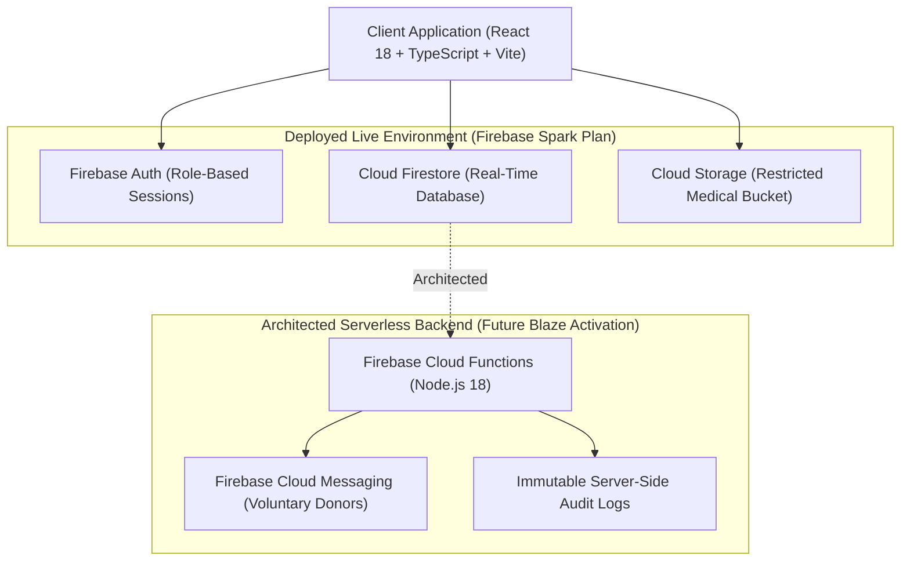
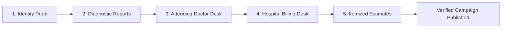

# LifeBridge India — Transparent Medical Support & Rare Disease Care Platform

[](https://www.typescriptlang.org/)
[](https://react.dev/)
[](https://vitejs.dev/)
[](https://firebase.google.com/)
[](LICENSE)
[](https://lifebridge-india.web.app)
[](#-production-testing--verification-evidence)

> **Live Deployed Web Application:** [https://lifebridge-india.web.app](https://lifebridge-india.web.app)  
> *(Alternative Firebase Alias: [https://lifebridge-india.firebaseapp.com](https://lifebridge-india.firebaseapp.com))*

LifeBridge India is a zero-commission medical-support platform designed to help rare-disease families navigate verification, treatment-support workflows, voluntary blood donor coordination, and transparent financial assistance.

The application addresses critical gaps in medical crowdfunding through a **5-stage human verification workflow**, **0% platform commission model**, **auditable financial transparency records with controlled backend writes**, and a **privacy-preserving voluntary blood donor matching network**.

---

## 🌐 Deployed vs. Architected System Status

> [!IMPORTANT]
> **Production Deployment Status**:  
> The web client application is **live and fully deployed** on Firebase Hosting CDN edge nodes under the free **Firebase Spark Plan**.  
>  
> **Serverless Backend Note**: Firebase Cloud Functions are designed as part of the backend architecture for background automated audit logging and FCM notification triggers. However, Cloud Functions are **currently not deployed in the live production environment** because Firebase Cloud Functions require a paid Firebase Blaze plan. All active production workflows function via client-side SDK calls enforced by declarative Cloud Firestore & Storage Security Rules.

| Subsystem / Feature | Production Status | Environment / Enforcement |
| :--- | :---: | :--- |
| **React 18 Single-Page Web Client** | 🟢 **Live Deployed** | Deployed on Firebase Hosting CDN ([https://lifebridge-india.web.app](https://lifebridge-india.web.app)) |
| **Firebase Authentication** | 🟢 **Live Deployed** | Active (Email/Password session persistence) |
| **Cloud Firestore Database** | 🟢 **Live Deployed** | Active with strict server-side `firestore.rules` |
| **Cloud Storage (Medical Bucket)** | 🟢 **Live Deployed** | Active under path `/medical_reports/{patientId}/*` with `storage.rules` |
| **7-Role Access Control (RBAC)** | 🟢 **Live Deployed** | Enforced client-side and validated backend-side |
| **5-Stage Hope Verification Standard** | 🟢 **Live Deployed** | Active multi-checkpoint verification pipeline |
| **Cloud Functions & FCM Serverless Workers** | 🟡 **Architected** | Not deployed in live ₹0 environment (Requires Firebase Blaze Plan) |

---

## 🏗️ System Architecture



---

## 👥 Role-Based Access Control (RBAC) Matrix

LifeBridge India isolates user capabilities using a **7-Role RBAC Model**. Privileged roles require backend authorization and cannot be self-assigned during registration.

| Role | Target Workspace User | Key System Capabilities | Security Rule Boundary |
| :--- | :--- | :--- | :--- |
| `DONOR` | Public Supporters | Browse verified campaigns, track transparent ledger transactions, search blood requests | Read-only campaigns & ledger; write own donor profile |
| `PATIENT_FAMILY` | Rare Disease Families | Create support applications, submit 5-stage medical verification documents | Read own profile; create/update own draft applications |
| `VOLUNTEER` | Ground Verifiers | Conduct identity & physical document verification, submit field audit reports | Read assigned applications; create verification logs |
| `DOCTOR` | Attending Physicians | Verify diagnostic reports, confirm medical necessity & treatment plan | Write doctor verification status on assigned cases |
| `HOSPITAL` | Billing Department | Upload hospital estimate certificates, confirm direct hospital bank settlement details | Write billing verification status & estimate proofs |
| `CSR` | Corporate Partners | Fund itemized treatment stages, review compliance documentation | Read full compliance records; update CSR sponsorship logs |
| `ADMIN` | Platform Auditors | Overlook system audit logs, review flagged applications, enforce compliance | Full administrative verification & compliance management |

---

## 🛡️ 5-Stage Hope Verification Standard

To ensure patient dignity and eliminate fraud, campaigns undergo a strict multi-checkpoint verification pipeline before being published:



1. **Identity Proof Check**: Government ID verification (Aadhaar / Voter ID / Passport) of patient and legal guardian.
2. **Diagnostic Medical Verification**: Clinical diagnostic reports (Genetic testing, EMG, Hemoglobin electrophoresis, Muscle biopsy) verified by medical verifiers.
3. **Attending Doctor Desk Confirmation**: Primary treating physician confirms medical diagnosis, prognosis, and treatment necessity.
4. **Hospital Billing Desk Validation**: Official hospital billing desk validates patient registration ID and hospital bank account credentials for direct disbursement.
5. **Itemized Treatment Estimate Audit**: Complete line-item breakdown of hospital care, medication costs (e.g., Nusinersen/Risdiplam for SMA), and ICU stay projections.

---

## 🔒 Security Architecture

LifeBridge India enforces security server-side via declarative rule manifests:

* **Authentication Boundary**: Powered by Firebase Auth Web SDK v10 with IndexedDB session persistence across page refreshes.
* **Firestore Security Rules ([`firestore.rules`](firestore.rules))**:
  * Strict schema validation for user profiles in `users/{uid}`.
  * Role self-elevation blocked: `request.resource.data.role == resource.data.role`.
  * Public access limited to `VERIFIED` and `APPROVED` campaigns only.
  * Auditable transparency records enforced with controlled backend writes.
* **Storage Access Rules ([`storage.rules`](storage.rules))**:
  * Medical documents restricted to `/medical_reports/{patientId}/*`.
  * Write access enforced so users can only upload to their own medical folder (`request.auth.uid == patientId`).
  * File size cap strictly enforced at **10 MB per file** with image/PDF MIME type whitelist.
* **Privacy-Preserving Blood Network**: Voluntary blood donor matching indexes donors by blood group and city without exposing private phone numbers or PII publicly.

---

## 🧪 Production Testing & Verification Evidence

The live production application at [https://lifebridge-india.web.app](https://lifebridge-india.web.app) underwent rigorous production smoke testing and static verification:

| Test Protocol | Status | Result / Metric | Evidence |
| :--- | :---: | :---: | :--- |
| **TypeScript Strict Compilation** | **PASS** | `0 errors` | Executed `npx tsc --noEmit` (Exit code 0) |
| **Production Vite Build** | **PASS** | Bundle compiled cleanly | Executed `npm run build` |
| **Live Site Availability** | **PASS** | HTTP 200 OK | Global CDN edge response on `lifebridge-india.web.app` |
| **Live Smoke Test Protocol** | **PASS** | **19 / 19 Passed** | Verified across all 19 functional checklist points |
| **Browser Runtime Errors** | **PASS** | `0 errors` | Chrome DevTools Console clean during live session |
| **CORS & Network Failures** | **PASS** | `0 failures` | Zero CORS blocking or failed API fetches |
| **Deep Route Page Refreshes** | **PASS** | `0 failures` | Single-page app rewrites correctly preserve route state |

---

## 🚀 Local Setup & Installation Guide

### Prerequisites
* Node.js v18.0.0 or higher
* npm v9.0.0 or higher

### 1. Clone Repository & Install Dependencies
```bash
git clone https://github.com/lifebridge-india/lifebridge-india.git
cd lifebridge-india
npm install
```

### 2. Start Development Server
```bash
npm run dev
```
The application will launch at `http://localhost:3000/` (or Vite default port `http://localhost:5173/`).

### 3. Type Checking & Verification
```bash
npx tsc --noEmit
```

### 4. Build Production Distribution
```bash
npm run build
```

---

## 🌐 Deployment Instructions

To deploy frontend hosting updates without modifying backend rules or Cloud Functions:

```bash
# Deploy static bundle to Firebase Hosting ONLY (Does NOT touch Cloud Functions)
npx firebase-tools deploy --only hosting -P lifebridge-india
```

> [!NOTE]
> **Firebase Billing Note**: Deployment commands specified above operate within the free **Firebase Spark Plan**. Do not deploy `--only functions` unless a paid Firebase Blaze plan has been explicitly enabled for the project.

---

## 📄 License

Distributed under the MIT License. See [`LICENSE`](LICENSE) for details.
