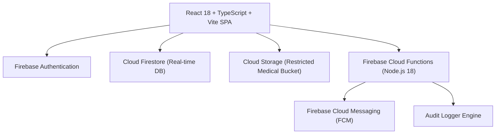

# LifeBridge India — System Architecture & Technical Design

## System Overview

LifeBridge India is a zero-commission, highly-verified medical support and rare disease care platform designed for high-impact pediatric treatment coordination (e.g., Spinal Muscular Atrophy, Duchenne Muscular Dystrophy, Thalassemia Major). The platform provides a multi-stakeholder audit ecosystem connecting patient families, attending doctors, hospital billing desks, voluntary blood donors, and corporate CSR entities.



---

## Component Architecture

### Frontend Layer
- **Framework**: React 18 with Strict TypeScript (`npx tsc --noEmit`)
- **Build System**: Vite 5.4 with HMR and Rollup production bundling
- **Styling**: Vanilla CSS tokenized design system (`src/styles/tokens.css`, `src/styles/global.css`)
- **Icons**: Lucide React iconography
- **State Management**: React Context (`AuthContext`) with single-source Firebase `onAuthStateChanged` persistence listener

### Backend & Cloud Infrastructure
- **Authentication**: Firebase Auth supporting Email/Password, Password Reset, and Token Session persistence
- **Database**: Cloud Firestore with declarative security rules (`firestore.rules`) and compound indexes (`firestore.indexes.json`)
- **Storage**: Firebase Storage for encrypted diagnostic PDF/image uploads under `/medical_reports/{patientId}/`
- **Serverless Compute**: Firebase Cloud Functions (`asia-south1`) executing background matching and AI assistant dispatch

---

## Key Subsystems

### 1. Multi-Stakeholder RBAC Engine
The application enforces granular Role-Based Access Control (RBAC) across 7 distinct roles:
1. `DONOR` — Community contributors and saved campaign managers
2. `PATIENT_FAMILY` — Application submitters and document uploaders
3. `VOLUNTEER` — Community campaign coordinators
4. `DOCTOR` — Verified pediatric specialists logging clinical updates
5. `HOSPITAL` — Hospital desk accounts uploading itemized treatment estimates
6. `CSR` — Corporate ESG compliance officers auditing grant settlements
7. `ADMIN` — Platform administrators executing final campaign verification

Role assignments are enforced backend-side in Firestore under `users/{uid}` and cannot be self-elevated by client requests.

### 2. Hope Verification Audit Engine
Instead of relying on unverified claims, every campaign is evaluated across 5 independent human verification checkpoints:
- **Identity Audit**: Proof of identity verification
- **Medical Report Audit**: Genetic and diagnostic report confirmation
- **Doctor Desk Verification**: Attending pediatric specialist confirmation
- **Hospital Desk Audit**: Official hospital desk treatment estimate validation
- **Treatment Estimate Audit**: Itemized financial requirement verification

The Hope Score ($S$) is calculated programmatically:
$$S = \sum_{i=1}^{5} w_i \cdot v_i \times 100\%$$
where $w_i = 0.20$ represents equal weight across all 5 verification checkpoints.

### 3. Open Financial Ledger Subsystem
LifeBridge India operates on a strict **0% platform fee** policy. Every contribution creates an immutable transaction record in the `transparency` collection containing:
- Transaction Reference ID
- Recipient Campaign Identifier
- Contribution Amount ($\text{INR}$)
- Payment Method
- Status (`INITIATED`, `PENDING`, `SUCCESSFUL`, `FAILED`, `REFUNDED`)
- Timestamp

---

## Directory Layout

```
lifebridge-india/
├── docs/                      # Architectural & Engineering Specifications
│   ├── architecture.md        # System Topology & Subsystems
│   ├── security.md            # RBAC & Security Rules Matrix
│   ├── data-model.md          # Firestore Schema & Specifications
│   ├── verification-workflow.md# 5-Stage Hope Verification Standard
│   ├── deployment.md          # CI/CD & Firebase Hosting Pipeline
│   └── testing.md             # Verification & Test Suite Strategy
├── functions/                 # Firebase Cloud Functions (Node.js)
├── src/                       # React 18 TypeScript Source Code
│   ├── components/            # UI Components & Dashboard Views
│   ├── context/               # AuthContext State Provider
│   ├── pages/                 # Application Views & Routes
│   ├── services/              # Firebase API SDK & Service Modules
│   ├── styles/                # CSS Tokens & Design System
│   └── types/                 # Data Models & Interfaces
├── firestore.rules            # Firestore Security Rules
├── storage.rules              # Cloud Storage Access Control Rules
├── firestore.indexes.json     # Firestore Compound Query Indexes
├── firebase.json              # Firebase Hosting & Services Manifest
├── package.json               # Node Package Manifest
├── tsconfig.json              # TypeScript Strict Compiler Config
├── vite.config.ts             # Vite Bundler & Dev Server Config
└── README.md                  # Main Repository Documentation
```
