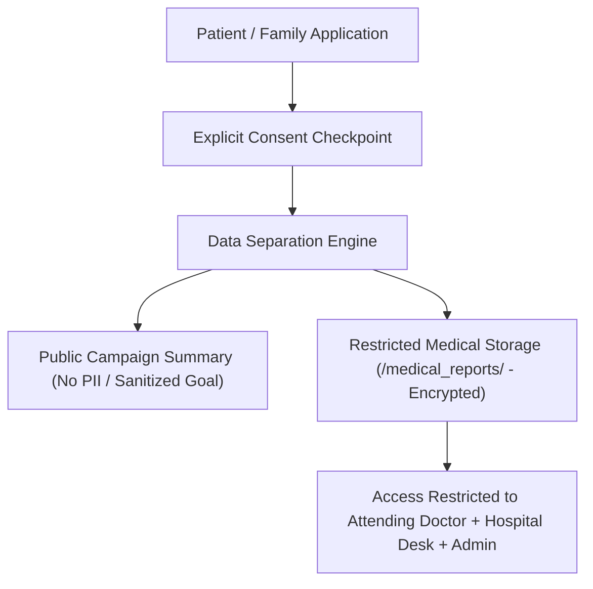

# LifeBridge India — Consent & Data Governance Specification (Phase 3)

**Version:** V1.1.1  
**Date:** October 2026  
**Status:** Approved Controlled-Pilot Governance Foundation  

---

## 1. Executive Summary & Purpose

LifeBridge India operates as a transparent medical-support platform connecting patients with verified campaigns, voluntary donor networks, and treating hospitals. This document establishes the foundational consent and data governance protocols required for controlled pilot operations and future clinical scaling.

---

## 2. Core Governance Principles

### A. Informed Patient / Guardian Consent
- Prior to submitting a medical support campaign or uploading medical diagnostic reports, patients (or legal guardians in the case of pediatric rare disease cases) must accept explicit digital consent.
- Consent covers:
  1. Authorization to perform human verification review of submitted diagnostic files.
  2. Authorization to publish a sanitized public campaign summary (excluding unredacted national IDs, home address, and direct phone contact).

### B. Purpose Limitation & Data Minimization
- Information collected is strictly limited to medical support verification, donor matching, and campaign audit logs.
- Patient diagnostic reports are stored in isolated, restricted storage paths (`/medical_reports/{patientId}/`) and are never used for commercial monetization or unauthorized data sharing.

### C. Institutional Verification Requirement
- Healthcare institutions, treating neurologists, and pediatric specialists undergo verification desk review before gaining privileged role access (`DOCTOR`, `HOSPITAL`, `CSR`).
- Controlled desk assignment prevents unverified self-elevation of administrative privileges.

---

## 3. Governance Policy Placeholders

> [!IMPORTANT]
> **Legal & Clinical Review Disclaimer**:  
> The following policy placeholders represent architectural frameworks and **require formal legal and clinical compliance review** prior to real-world clinical data deployment.

### A. Data Retention & Deletion Policy *(Policy Placeholder)*
- **Active Cases:** Patient campaign records and verification audits are retained for the duration of active treatment monitoring plus mandatory compliance archiving (7 years standard medical audit).
- **Deletion Requests:** Users may request account scrub and data deletion. Profile data is anonymized, and public campaign summaries are unlinked from personal identifiers under applicable privacy regulations.
- *(Requires legal/clinical review before real-world deployment.)*

### B. Consent Withdrawal Process *(Policy Placeholder)*
- Patients or legal guardians may withdraw consent at any time through the platform privacy portal or by contacting the verification desk.
- Upon consent withdrawal, active public campaigns are suspended, and document access permissions are revoked to `ADMIN` view only.
- *(Requires legal/clinical review before real-world deployment.)*

### C. Security Incident Response Protocol *(Policy Placeholder)*
- In the event of a suspected security incident or data breach attempt:
  1. Storage download access tokens for affected paths are invalidated immediately.
  2. The incident response team conducts a log audit of `/auditLogs` and Firebase authentication streams.
  3. Affected users and relevant regulatory bodies are notified in accordance with statutory timelines.
- *(Requires legal/clinical review before real-world deployment.)*

---

## 4. Separation of Public vs. Private Case Data

