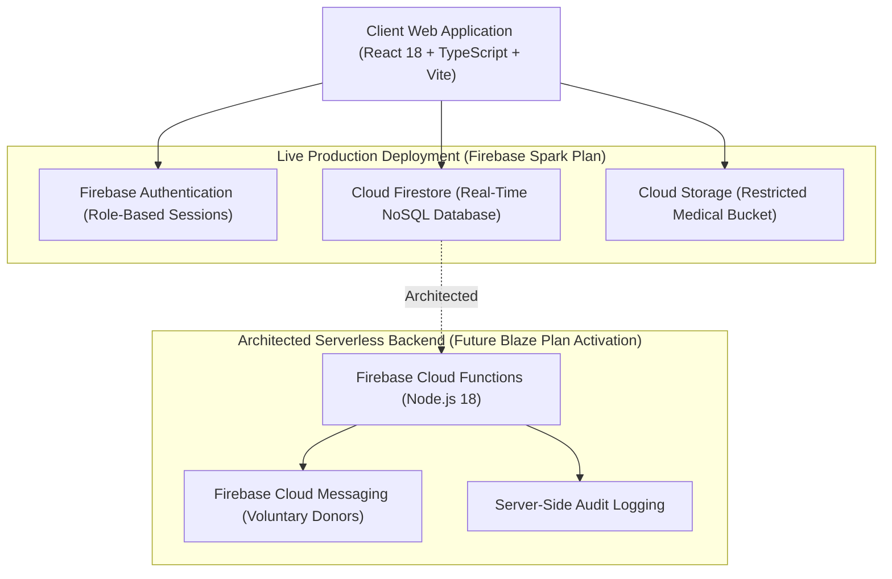

# Case Study: LifeBridge India — Transparent Medical Support & Rare Disease Care Platform

**Live Web Application:** [https://lifebridge-india.web.app](https://lifebridge-india.web.app)  
**Developer:** Single Software Engineer Showcase  
**Release Version:** V1.1.0 (Live Verified)  
**Tech Stack:** React 18, TypeScript, Vite, Firebase Web SDK v10 (Auth, Cloud Firestore, Cloud Storage), Tokenized CSS  

---

## 1. Problem Statement
Rare pediatric diseases—such as Spinal Muscular Atrophy (SMA), Duchenne Muscular Dystrophy (DMD), and Thalassemia Major—present catastrophic financial and medical challenges for families in India. Treatments like Zolgensma or Spinraza can cost millions of rupees, forcing families to rely on crowdfunded medical support.

However, existing crowdfunding ecosystems suffer from:
* **Opacity and High Platform Fees**: High platform commissions (5% to 15%) eat into life-saving medical funds.
* **Verification Gaps**: Pervasive fraud and unverified campaigns make donors skeptical.
* **Privacy Risks**: Medical documents, sensitive diagnostic reports, and personal phone numbers are often leaked or publicly exposed.
* **Emergency Blood Supply Coordination Deficits**: Rare blood group coordination during surgery or transfusion remains fragmented.

---

## 2. Why LifeBridge India Was Built
LifeBridge India was designed to solve these systemic challenges through a **0% platform commission model**, a **5-stage human medical verification pipeline**, **auditable financial transparency records with controlled backend writes**, and a **privacy-preserving voluntary blood donor matching network**.

The goal of this project was not to build another generic CRUD web app, but to architect a production-grade, secure, multi-role web platform that proves how technology can introduce absolute transparency into medical assistance workflows.

---

## 3. Product Approach
* **Human-Centered Hope Verification**: Campaigns progress through 5 strict verification checkpoints before public release.
* **Role-Isolated Workspaces**: 7 distinct workspaces designed specifically for Donors, Families, Volunteers, Doctors, Hospitals, CSR partners, and Auditors.
* **Zero Commission Transparency**: Platform fee is strictly 0%, recording auditable ledger entries for all verified contributions.
* **Strict Privacy by Default**: Patient identity proofs and medical diagnostic files are restricted to authorized verifiers and treating medical desks.

---

## 4. System Architecture



---

## 5. Firebase Architecture
* **Firebase Web SDK v10 (Modular)**: Tree-shaken imports minimizing bundle size.
* **Session Persistence**: Managed via Firebase Auth `onAuthStateChanged` connected to `users/{uid}` profile documents in Cloud Firestore.
* **Declarative Security Rules**: Server-side declarative enforcement using `firestore.rules` and `storage.rules`.

---

## 6. Seven-Role Access Control (RBAC)

The application enforces a 7-role access hierarchy:

```
[Public Visitor] ──► DONOR (View Verified Campaigns & Transparency Ledger)
                 ├──► PATIENT_FAMILY (Create Applications & Upload Documents)
                 ├──► VOLUNTEER (Conduct Field Verification & Submit Audit Reports)
                 ├──► DOCTOR (Verify Diagnosis & Clinical Necessity)
                 ├──► HOSPITAL (Validate Billing & Hospital Bank Accounts)
                 ├──► CSR (Fund Treatment Stages & Review Compliance)
                 └──► ADMIN (Enforce Overall System Audit & Compliance)
```

Privileged roles (`ADMIN`, `DOCTOR`, `HOSPITAL`, `CSR`) require manual backend authorization and cannot be self-assigned during registration.

---

## 7. Five-Stage Hope Verification Workflow

1. **Identity Proof**: Aadhaar/Voter ID verification of guardian and patient.
2. **Diagnostic Reports**: Verification of EMG, genetic sequencing, or blood panel reports.
3. **Attending Doctor Desk**: Direct confirmation by treating physician.
4. **Hospital Billing Desk**: Validation of hospital registration ID and official hospital bank account.
5. **Itemized Estimate Audit**: Verification of itemized hospital treatment estimates.

---

## 8. Medical-Document Privacy
Patient files (genetic reports, hospital estimates) are stored under Cloud Storage path `/medical_reports/{patientId}/*`. 

Access rules strictly enforce that:
- Patients can only upload to their own directory (`request.auth.uid == patientId`).
- Only verified verifiers, treating doctors, and hospital desks can access private medical documents.
- File sizes are capped at 10 MB per upload.

---

## 9. Financial Transparency Design
To prevent accounting tampering, financial transactions record entries in the `transparency` Firestore collection.
- Every contribution records an auditable record.
- 0% platform commission model ensures 100% of assistance funds are allocated directly toward hospital treatment estimates.
- Writes to ledger entries are restricted server-side.

---

## 10. Voluntary Blood Donor Coordination Network
Search and standby matching network for rare blood groups (e.g., O negative, Bombay blood group, A negative) across Indian cities:
- Voluntary donors register their blood group and city.
- Contact phone numbers and PII are never publicly displayed.
- Emergency requests trigger location/group matches.

---

## 11. AI Safety Boundaries
The platform includes an AI support interface (LifeBridge AI) designed with strict safety boundaries:
- Provides medical terminology explanations for complex rare disease terms (e.g., SMN1 gene deletion).
- Strictly blocks diagnostic or prescription generation.
- Appends mandatory medical disclaimer notices urging consultation with qualified medical professionals.

---

## 12. Testing and Verification Evidence
Live site verification was conducted on `https://lifebridge-india.web.app`:
* **TypeScript Strict Compilation**: `0 errors` (`npx tsc --noEmit`).
* **Vite Production Build**: Clean bundle compilation (`npm run build`).
* **Live Smoke Test Protocol**: **19 / 19 PASSED**.
* **Browser Runtime Exceptions**: 0 reported in Chrome DevTools.
* **Network / CORS Failures**: 0 reported.

---

## 13. Deployment Pipeline
* **Hosting**: Firebase Hosting CDN edge distribution.
* **Single-Page Application (SPA) Rewrites**: Configured in `firebase.json` so deep routes (e.g., `/transparency`, `/apply`) render correctly on refresh.
* **Deployment Command**: `npx firebase-tools deploy --only hosting -P lifebridge-india`.

---

## 14. Current Limitations & Scope
* **Firebase Spark Plan**: Cloud Functions and automated background FCM push workers are architected but remain undeployed due to Spark tier limits (requires Firebase Blaze upgrade).
* **Payment Gateway**: Platform operates on direct hospital account disbursement instructions; no third-party card processing gateway is integrated.
* **Controlled Pilot State**: Demo campaigns and test profiles are used for workflow validation.

---

## 15. Future Real-World Validation
* Integration with hospital ABHA (Ayushman Bharat Digital Mission) health IDs.
* Deployment of serverless Cloud Functions on Firebase Blaze plan.
* Pilot partnerships with verified rare disease advocacy foundations across India.

---

## 🎬 60–90 Second Demo Video Script

**Title:** LifeBridge India — Architecture & Workflow Walkthrough  
**Duration:** 75 Seconds  
**Narrator:** Single Developer / Creator  

---

### [0:00 - 0:15] Introduction & The Problem
* **Visual:** Full-screen capture of the live homepage at `https://lifebridge-india.web.app`. Scrolling over hero section and Hope badges.
* **Voiceover:** *"Hi, I'm the developer of LifeBridge India — a zero-commission medical support platform for rare pediatric diseases like SMA and Thalassemia. Existing crowdfunding platforms often charge 5% to 15% fees and lack transparent verification. Here is how I engineered a secure, transparent solution."*

---

### [0:15 - 0:35] 5-Stage Verification & RBAC Workspaces
* **Visual:** Click on a campaign card showing the "5-Stage Hope Verification Standard" progress bar, then open the "Sign In" modal showing role selection.
* **Voiceover:** *"Every campaign must pass five strict verification checkpoints—from identity proof to attending doctor and hospital billing desk validation. I implemented a 7-Role Access Control system using Firebase Auth and Cloud Firestore, keeping donor, doctor, hospital, and patient family workspaces completely isolated."*

---

### [0:35 - 0:55] Financial Transparency & Medical Document Privacy
* **Visual:** Navigate to `/transparency` showing the open ledger, then briefly highlight the storage rules enforcing `/medical_reports/{uid}/*` privacy.
* **Voiceover:** *"Financial transparency is paramount. The platform records auditable transparency records with a strict 0% commission policy. Sensitive patient medical reports are stored in restricted Cloud Storage buckets enforced by server-side declarative security rules."*

---

### [0:55 - 0:75] Live Smoke Test & Wrap-Up
* **Visual:** Show browser Developer Tools console showing zero errors, then transition to mobile view showing responsive layout.
* **Voiceover:** *"The platform is live on Firebase Hosting edge nodes, passing a 19-point production smoke test with zero TypeScript compilation errors. Thank you for watching!"*
