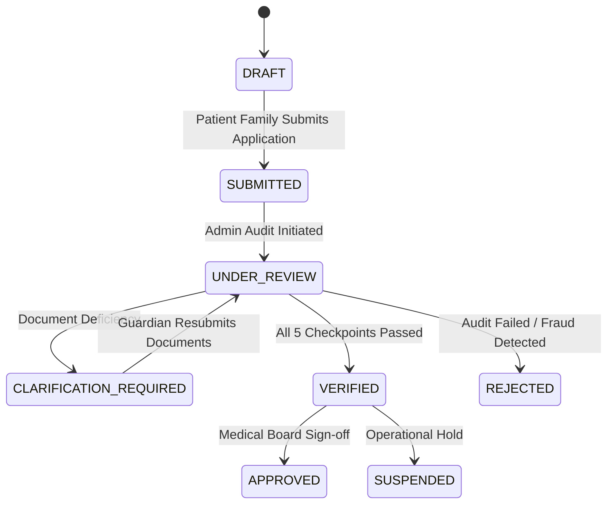

# LifeBridge India — 5-Stage Hope Verification Standard

## Executive Summary

The primary failure point of traditional medical crowdfunding is lack of trust: unverified claims, fabricated medical reports, or unconfirmed financial estimates. LifeBridge India solves this through a mandatory **5-Stage Hope Verification Audit Model**.

No campaign appears as verified on the platform without completing independent human verification checkpoints.

---

## The 5 Verification Checkpoints

```
[Patient Submission] ➔ [Stage 1: Identity] ➔ [Stage 2: Medical Reports] ➔ [Stage 3: Doctor Desk] ➔ [Stage 4: Hospital Desk] ➔ [Stage 5: Financial Estimate] ➔ [VERIFIED CAMPAIGN]
```

### Stage 1: Identity Proof Audit
- **Objective**: Confirm patient identity, legal guardian credentials, and residential location.
- **Reviewer Role**: Admin / Identity Review Desk
- **Checklist Item**: `verification.identityVerified = true`

### Stage 2: Diagnostic & Genetic Report Audit
- **Objective**: Review diagnostic reports, genetic variant sequencing (e.g. SMN1 gene deletion for SMA, dystrophin mutation for DMD), and bone marrow biopsy records.
- **Reviewer Role**: Admin Medical Audit Desk
- **Checklist Item**: `verification.medicalReportsVerified = true`

### Stage 3: Attending Specialist Verification
- **Objective**: Direct clinical confirmation with the treating pediatric specialist or neurologist regarding dosing protocol and treatment necessity.
- **Reviewer Role**: `DOCTOR` (Pediatric Specialist)
- **Checklist Item**: `verification.doctorVerificationCompleted = true`

### Stage 4: Hospital Desk Audit
- **Objective**: Verification with the official hospital administration or billing desk regarding admission, treatment scheduling, and ICU allocation.
- **Reviewer Role**: `HOSPITAL` (Hospital Desk Coordinator)
- **Checklist Item**: `verification.hospitalDeskVerified = true`

### Stage 5: Itemized Cost Estimate Audit
- **Objective**: Audit of itemized hospital pro-forma invoices, drug importation quotes (e.g., Zolgensma, Exon-skipping therapies), and pharmacy estimates.
- **Reviewer Role**: Admin / Hospital Accounts
- **Checklist Item**: `verification.treatmentEstimateVerified = true`

---

## Hope Score Calculation Algorithm

The Hope Verification Score ($H$) is calculated dynamically from completed checkpoints:

$$H = \frac{N_{\text{completed}}}{5} \times 100\%$$

| Completed Checkpoints | Hope Score | Status Display |
|:---:|:---:|---|
| 1 / 5 | 20% | `SUBMITTED` — Verification in progress |
| 2 / 5 | 40% | `UNDER_REVIEW` — Document audit active |
| 3 / 5 | 60% | `UNDER_REVIEW` — Clinical confirmation pending |
| 4 / 5 | 80% | `CLARIFICATION_REQUIRED` / Reviewing hospital desk |
| 5 / 5 | 100% | `VERIFIED` — Full multi-stakeholder approval |

---

## State Transition Matrix



---

## Mandatory Audit Logging

Every state transition or checklist mutation writes an immutable entry into the `auditLogs` collection:

```json
{
  "actor": "usr_admin_901",
  "actorRole": "ADMIN",
  "action": "CAMPAIGN_VERIFIED_STAGE_3",
  "affectedRecord": "patients/pt_sma_01",
  "previousState": { "doctorVerificationCompleted": false, "hopeScorePercentage": 40 },
  "newState": { "doctorVerificationCompleted": true, "hopeScorePercentage": 60 },
  "timestamp": "2026-09-02T14:30:00.000Z"
}
```
